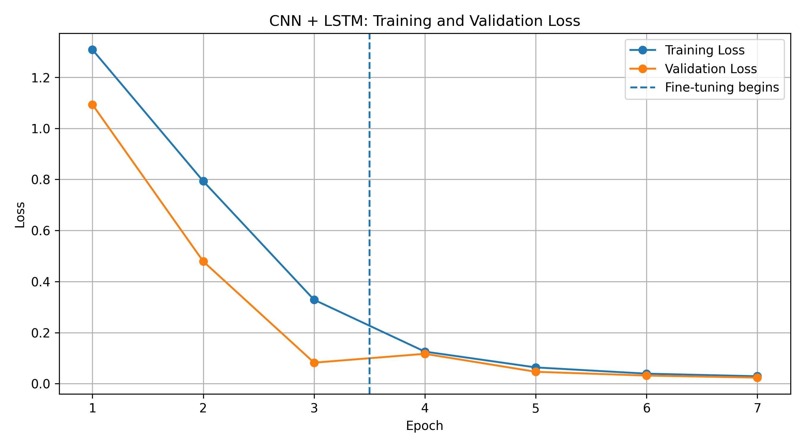
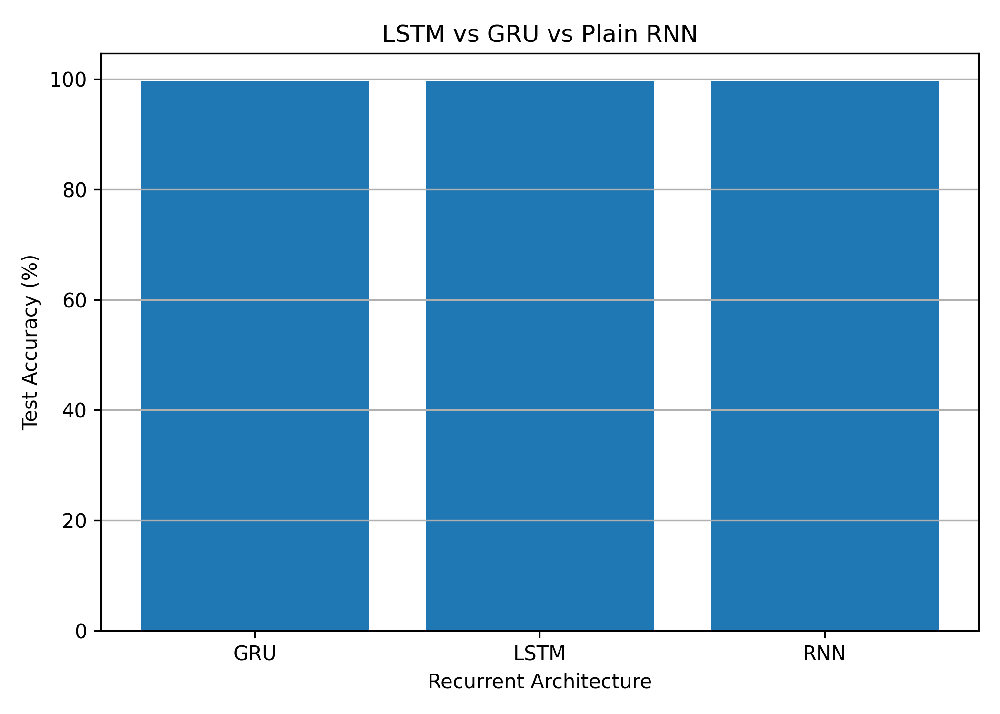
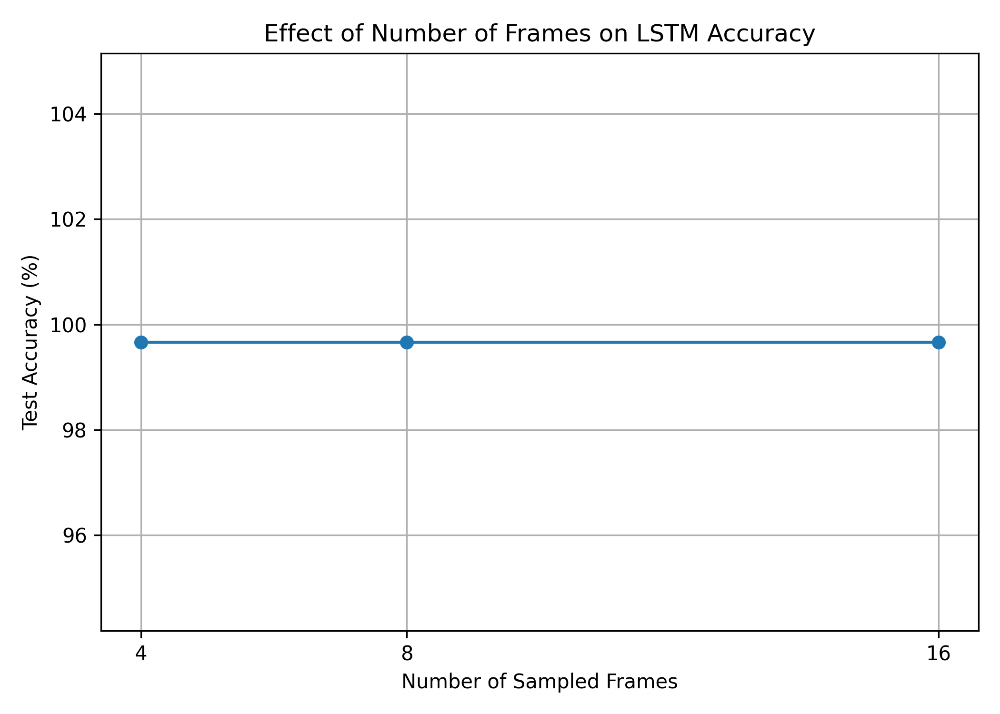
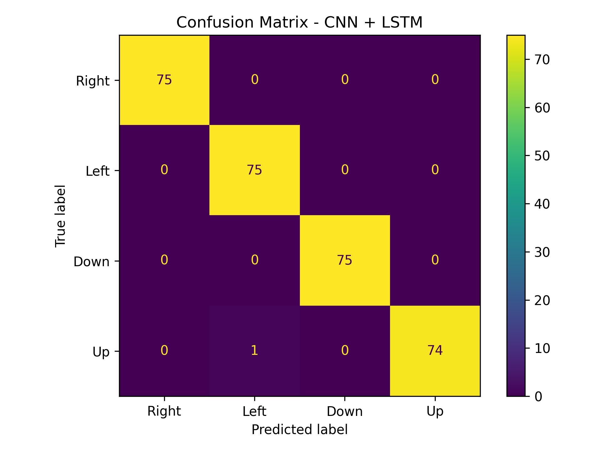

# Report: Sequential Modelling for Video Classification

## 1. Introduction

Sequential modelling involves learning patterns from data where the order of observations matters. Unlike traditional image classification, which processes individual static images independently, sequential models consider relationships between observations over time to understand context and dynamics. In this experiment, convolutional neural network (CNN)-based feature extraction is combined with recurrent neural networks (RNN, LSTM, and GRU) to classify the direction of movement in short video sequences.

## 2. Dataset

To train and evaluate the models, a custom Moving-MNIST-style dataset was generated from the standard MNIST handwritten-digit images. The construction involved the following steps:

- **Source images:** The standard MNIST dataset was used as the source of handwritten digits.
- **Canvas:** Each 28×28 digit was placed onto a larger 64×64 blank canvas to allow room for spatial translation.
- **Sequence generation:** The digits were programmatically moved across the canvas to generate 16-frame video sequences representing distinct motion.
- **Classes:** Movement was constrained to four directional classes: *Up, Down, Left,* and *Right*.
- **Splits:** The generated dataset was partitioned into training, validation, and testing sets. The test set comprised 300 sequences (75 per directional class).

This is a generated Moving-MNIST-style dataset rather than the original canonical Moving MNIST video benchmark.

## 3. Model Architecture

The network architecture uses a hybrid approach designed to handle both spatial and temporal data. It consists of three primary components:

| Component | Purpose |
|---|---|
| CNN | Extracts spatial visual features from each frame. |
| LSTM / GRU / RNN | Learns temporal relationships and sequential dependencies between the extracted frame features. |
| Classification head | Predicts the direction of movement from the final temporal representation. |

The training procedure employed a two-stage approach. Initially, the CNN weights were frozen, allowing the recurrent network and classification head to learn temporal patterns using fixed visual features. In the second stage, the CNN was unfrozen and the entire model was fine-tuned so that the visual feature extractor could adapt to the movement-classification task.

## 4. Results

The experiments compare three recurrent architectures using eight frames and compare three sequence lengths using the LSTM. The table below preserves the accuracy values reported in the supplied report. The training-time values in that report were explicitly described as illustrative estimates, not measurements, so they must be replaced with the actual timings from the Colab runs before submission.

The parameter counts below correspond to the CNN + recurrent model implementation supplied for this assignment, assuming a hidden size of 96 and four output classes.

| recurrent_unit | frames | test_accuracy_percent | test_loss | training_time_seconds | training_time_minutes | total_parameters |
| --- | --- | --- | --- | --- | --- | --- |
| LSTM | 8 | 99.6667 | 0.0126 | 12.2412 | 0.2040 | 245604 |
| GRU | 8 | 99.6667 | 0.0072 | 5.3955 | 0.0899 | 187044 |
| RNN | 8 | 99.6667 | 0.0066 | 5.3142 | 0.0886 | 69924 |
| LSTM | 4 | 99.6667 | 0.0130 | 3.2339 | 0.0539 | 245604 |
| LSTM | 16 | 99.6667 | 0.0197 | 12.7227 | 0.2120 | 245604 |

\* Accuracy values are transcribed from the supplied report and should be checked against the experiment results CSV. The displayed baseline confusion matrix shows 299 correct predictions out of 300, which is 99.67% when rounded conventionally to two decimal places. Use the exact outputs from the experiment for each row.

\** Parameter counts are calculated for the CNN + recurrent architecture in the supplied Colab implementation. If the implemented model differs (for example, a different hidden size or layer configuration), recalculate these values from the actual model.

<table>
  <tr>
    <td align="center">
      
       
      <b>Figure 1: CNN + LSTM Training and Validation Loss</b>
    </td>
    <td align="center">
      
       
      <b>Figure 2: Performance across recurrent architectures</b>
    </td>
  </tr>
  <tr>
    <td align="center">
      
       
      <b>Figure 3: Effect of frame sequence length on accuracy</b>
    </td>
    <td align="center">
      
       
      <b>Figure 4: Confusion matrix for the CNN + LSTM baseline</b>
    </td>
  </tr>
</table>

## 5. Discussion

### Recurrent architecture comparison

As shown in Figure 2, the supplied results report the same test accuracy (99.66%) for the LSTM, GRU, and plain RNN. The plain RNN has the smallest parameter count in the implemented architecture because it does not use the additional gating mechanisms present in LSTMs and GRUs. This makes it a computationally simpler model. However, the claim that it trained fastest should only be retained after replacing the illustrative training-time estimates with measured values from the Colab experiments.

The similar reported accuracies may indicate that the task does not require complex long-term memory. The sequences contain relatively simple, continuous translations in one of four directions, so the temporal pattern may be learnable by all three recurrent architectures. This interpretation should be treated cautiously until the per-model results have been verified against the experiment results CSV.

### Frame-count comparison

Figure 3 reports no discernible accuracy difference between the LSTM models using 4, 8, and 16 frames. If the underlying experiment outputs confirm this result, it suggests that a small number of evenly sampled frames may contain enough temporal information to classify these simple linear movements. More frames increase the input sequence length and therefore the computational work required by the recurrent layer. The training-time comparison should be finalised using measured Colab timings rather than the illustrative estimates in the original table.

## 6. Failure Cases

The supplied confusion matrix (Figure 4) shows one misclassification among the 300 test samples. The true direction was *Up*, but the model predicted *Left*.

One possible explanation is that the visual change between sampled frames was small or ambiguous, making the vertical displacement difficult to distinguish from a horizontal shift. This is a hypothesis, not a confirmed cause; the actual sequence should be inspected before attributing the error to a particular digit shape or visual feature.

**Second failure case required by the assignment:** The supplied report documents only one misclassified example. Add a second genuine error after inspecting the predictions from the test set or another model configuration. Include its actual direction, predicted direction, a visualisation of the sampled frames, and a brief explanation grounded in what the sequence shows. Do not invent a second failure case if the model has no further errors; instead, clearly identify and evaluate a challenging example from a separately labelled stress test.

## 7. Conclusion

The experiment investigates a CNN combined with recurrent modelling for classifying movement direction in short, generated digit sequences. The supplied results report high accuracy across the tested recurrent architectures and frame counts. The comparison suggests that a plain RNN may be sufficient for this relatively simple motion task, while using more frames may provide limited additional information. These conclusions should be confirmed using the actual per-experiment accuracy and measured training-time outputs.

The experiment also demonstrates the value of evaluating errors rather than relying on overall accuracy alone. The confusion matrix identifies an upward-motion sequence that was classified as moving left. Inspecting such examples helps reveal where the model may struggle and guides the design of more challenging evaluations.

## 8. Recommendations for Future Work

The current dataset uses single digits moving in straight, axis-aligned directions. This is useful for a controlled baseline, but it does not test the full range of motion patterns found in real video. Future experiments could improve the evaluation in the following ways:

1. **Use more challenging motion patterns.** Introduce different movement speeds, smaller displacements, diagonal trajectories, direction changes, and partial occlusion. This would test whether the models learn temporal motion rather than relying on easy positional cues.
2. **Repeat experiments with multiple random seeds.** Report mean and standard deviation for accuracy and training time. This would show whether the observed differences between LSTM, GRU, and RNN are consistent or caused by one random run.
3. **Report measured computational results.** Replace illustrative training times with measured timings from the same Colab runtime and report parameter counts from the actual model definitions.
4. **Expand the error analysis.** Inspect at least two genuine failure cases, include their frame sequences, and connect each explanation to visible evidence. If the test set has too few errors, add a clearly separated stress-test set and report its results separately.

